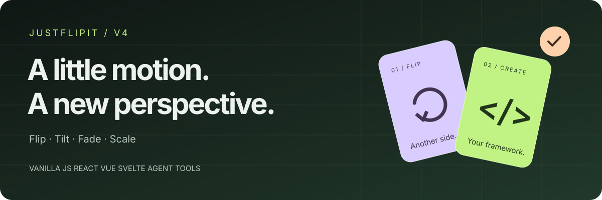
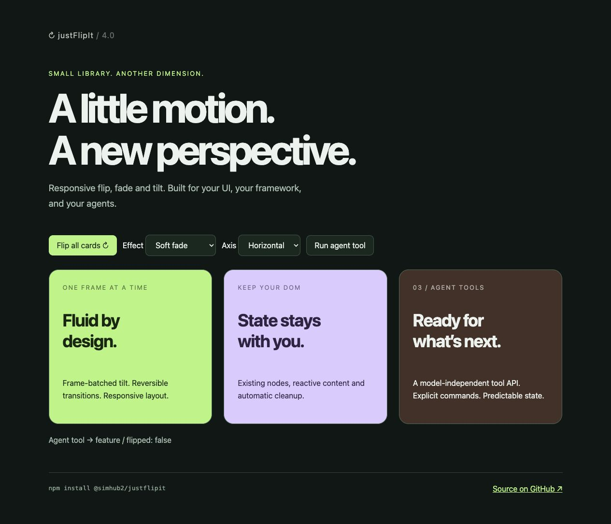

<p align="center">
  
</p>

<p align="center">
  <a href="https://www.npmjs.com/package/@simhub2/justflipit"></a>
  <a href="https://github.com/SimHub/justFlipIt/actions/workflows/ci.yml"></a>
  <a href="LICENSE"></a>
  <a href="#frameworks"></a>
</p>

<p align="center">
  Responsive flip and tilt animations for your UI.<br>
  One dependency-free core. Native framework lifecycles. Model-independent agent tools.
</p>

<p align="center">
  <a href="#quick-start">Quick start</a> ·
  <a href="#frameworks">React / Vue / Svelte</a> ·
  <a href="#agent-tools">Agent tools</a> ·
  <a href="#options">Options</a> ·
  <a href="#upgrading-from-v3">Upgrade from v3</a>
</p>

---

## A card with more to say

Build product cards, reveal details, or let an agent control a card through explicit tool calls. Choose a 3D flip, a soft fade, or a scale transition, then add pointer-driven tilt.



**[Browse the demo source →](example/index.html)** · Run locally with `npm run build` and `python3 -m http.server 4173`, then open [localhost:4173/example/](http://localhost:4173/example/).

| Motion that responds | Fits your application | Control when you need it |
|---|---|---|
| Flip on either axis, fade, and scale | React hook, Vue directive, Svelte action | `flip`, `toggle`, `update`, and state inspection |
| Pointer tilt batched per animation frame | Existing framework-owned faces stay in place | Model-independent JSON-schema tool definition |
| Touch, keyboard, and reduced-motion support | Responsive layout and SSR-safe imports | Typed API and change events |

## Quick start

```sh
npm install @simhub2/justflipit
```

Add a container to your page, then initialize it after the element exists:

```html
<div class="product-card">
  <h2>A different perspective</h2>
  <p>Click to discover the other side.</p>
</div>
```

```js
import justFlipIt from '@simhub2/justflipit';

const card = justFlipIt(document.querySelector('.product-card'), {
  Click: true,
  Template: '<h2>There is more to see.</h2><p>Your details go here.</p>',
  Tilt: { max: 10, perspective: 1000, scale: 1.03 },
  Duration: 450,
});
```

The original node and its event listeners are preserved. Both faces participate in a responsive grid, so the card adapts to its content. Style the faces to match your design; the core supplies the motion and layout.

> `Template` accepts trusted application HTML. Use the agent bridge's `setText` action for model-generated text. With a framework, render content through the framework instead.

<details>
<summary><strong>Using a browser script or CommonJS?</strong></summary>

**Browser script — no bundler:**

```html
<div class="card">Front of the card</div>
<script src="https://cdn.jsdelivr.net/npm/@simhub2/justflipit@4.0.0/dist/justFlipIt.min.js"></script>
<script>
  justFlipIt('.card', { Click: true, Template: '<p>Back of the card</p>' });
</script>
```

**CommonJS:**

```js
const justFlipIt = require('@simhub2/justflipit');
```

The browser bundle exposes `window.justFlipIt`. ESM and CommonJS imports include matching TypeScript declarations.

</details>

## Frameworks

Use two direct child elements as the front and back faces. The adapters attach behavior to those existing nodes, so reactive content remains owned by your framework.

| Framework | Import | Integration | Cleanup |
|---|---|---|---|
| React 18+ | `@simhub2/justflipit/react` | `useFlip()` hook | Effect cleanup; StrictMode compatible |
| Vue 3 | `@simhub2/justflipit/vue` | `vFlip` directive | `beforeUnmount` |
| Svelte 4/5 | `@simhub2/justflipit/svelte` | `flip` action | Action `destroy()` |
| Other frameworks | `@simhub2/justflipit` | Core with `Faces` selectors | Call `destroy()` before unmount |

<details open>
<summary><strong>React</strong> — hook, ref and controller</summary>

```jsx
import { useFlip } from '@simhub2/justflipit/react';

export function ProductCard({ title, details }) {
  const { ref, controller } = useFlip({ Click: true, Tilt: true });

  return (
    <section>
      <div ref={ref}>
        <div data-flip-front>{title}</div>
        <div data-flip-back>{details}</div>
      </div>
      <button onClick={() => controller.current?.toggle()}>Flip card</button>
    </section>
  );
}
```

In Next.js App Router, put this hook in a Client Component with `'use client'`.

</details>

<details>
<summary><strong>Vue 3</strong> — directive with reactive options</summary>

```vue
<script setup>
import { vFlip } from '@simhub2/justflipit/vue';

defineProps({ title: String, details: String });
</script>

<template>
  <div v-flip="{ Click: true, Effect: 'scale' }">
    <div data-flip-front>{{ title }}</div>
    <div data-flip-back>{{ details }}</div>
  </div>
</template>
```

</details>

<details>
<summary><strong>Svelte</strong> — action with lifecycle updates</summary>

```svelte
<script>
  import { flip } from '@simhub2/justflipit/svelte';
</script>

<div use:flip={{ Click: true, Tilt: true }}>
  <div data-flip-front>Front</div>
  <div data-flip-back>Details</div>
</div>
```

</details>

**Lifecycle notes:** Imports are safe during server rendering; initialize DOM controllers on the client. Keep `Faces` selectors stable while mounted. Render framework content through application state and omit `Template`. Avoid simultaneously managing the plugin's style, class and accessibility attributes from your framework.

## Agent tools

Connect any agent runtime that supports tool calls. Register the cards your agent may control, supply the exported schema to your runtime, and pass parsed tool arguments to the executor.

```js
import justFlipIt from '@simhub2/justflipit';
import { createAgentBridge } from '@simhub2/justflipit/agent';

const product = justFlipIt(document.querySelector('.product-card'), {
  Click: true,
});
const bridge = createAgentBridge({ product });

// Wrap this definition in the tool format expected by your agent runtime.
const tool = bridge.tool;

// Execute the parsed arguments from a tool call.
bridge.execute({ id: 'product', action: 'setText', text: 'Selected for you.' });
const result = bridge.execute({ id: 'product', action: 'flip' });
// { id: 'product', flipped: true, destroyed: false, effect: 'flip' }
```

| Action | Result |
|---|---|
| `state` | Read the card's current state |
| `flip` | Show the back |
| `reset` | Show the front |
| `toggle` | Switch sides |
| `setText` | Replace the generated back face with plain text |

The bridge validates commands and accepts only registered card IDs. `setText` uses `textContent`, accepts up to 100,000 characters, and rejects framework-managed cards; update framework content through application state.

The executor runs in the browser alongside the DOM. Relay server-side tool calls through your application. The package provides a schema and executor; your application supplies the agent runtime and any model credentials.

## Controller API

```js
card.flip();                          // Show back
card.flip(false);                     // Show front
card.toggle();                        // Switch sides
card.update({ Effect: 'fade' });       // Change options in place
card.getState();                       // { flipped, destroyed, effect }
card.destroy();                        // Remove listeners and restore the element
```

| Call | Returns |
|---|---|
| `justFlipIt(element, options)` | One controller |
| `justFlipIt(selectorOrCollection, options)` | An array of controllers |
| `justFlipIt.get(element)` | Existing controller, or `undefined` |
| `justFlipIt.destroy(target)` | Destroys matching instances |

Repeated initialization returns the existing instance. Use `update()` to change its options. `destroy()` is safe to call more than once. Initialize an HTML container, such as a `div`, rather than a void element such as `img`.

```js
card.hoverPanel.addEventListener('justflipit:change', ({ detail }) => {
  console.log(detail.flipped, detail.effect);
});
```

## Options

| Option | Default | What it controls |
|---|---|---|
| `Click` | `false` | Hover by default; `true` for click; a selector or selector array for delegated clicks |
| `FlipX` | `false` | X-axis rotation instead of Y-axis |
| `Template` | Clone of original | Trusted HTML for a generated back face |
| `Duration` | `400` | Non-negative duration in milliseconds |
| `Easing` | `cubic-bezier(.22,.61,.36,1)` | CSS easing function |
| `Effect` | `'flip'` | `'flip'`, `'fade'`, or `'scale'` |
| `Tilt` | `false` | `true`, `'only'`, or `{ max, perspective, scale }` |
| `ReducedMotion` | `true` | Respect live `prefers-reduced-motion` preferences |
| `Faces` | Omitted | Existing direct children: `{ front: selector, back: selector }` |
| `preserveClasses` | `true` | Copy original classes onto a generated container |
| `preserveStyles` | `true` | Copy original inline styles onto a generated container |
| `Style` | `[]` | Apply `{ el: 'self' or selector, style: {...} }` entries |

<details>
<summary><strong>Style existing faces and choose a different effect</strong></summary>

```js
justFlipIt(document.querySelector('.card'), {
  Faces: { front: '[data-front]', back: '[data-back]' },
  Click: true,
  FlipX: true,
  Effect: 'scale',
  Duration: 500,
  Style: [
    { el: '[data-front]', style: { background: '#243b2b', borderRadius: '20px' } },
    { el: '[data-back]', style: { background: '#c1f384', borderRadius: '20px' } },
  ],
});
```

</details>

## Motion and accessibility

- **Reversible transitions:** Rapid input reverses the current CSS transition without accumulating animation objects.
- **Efficient tilt:** Pointer updates share one animation frame; touch scrolling remains native.
- **Keyboard:** Focus the card, then use Enter or Space to toggle and Escape to reset.
- **Touch:** Tap to flip in hover mode, or choose `Click: true` explicitly.
- **Hidden faces:** The inactive face is inert and marked `aria-hidden`.
- **Reduced motion:** System preference changes disable transitions and tilt automatically. Set `ReducedMotion: false` only when your application intentionally overrides this preference.

Targets modern browsers with CSS Grid, Pointer Events, and native `inert` support. Add application-level polyfills when targeting older browsers. SSR safety covers importing the package; DOM initialization requires a browser.

## Upgrading from v3

**v4 is a major release.** Check these changes before upgrading an existing integration:

| v3 integration | v4 equivalent |
|---|---|
| UMD-only npm entry | Default ESM import or callable CommonJS export |
| Optional jQuery plugin registration | Call `justFlipIt(...)` directly |
| Separate modern / vanilla / combined implementations | One core; historical import paths and browser filenames remain aliases |
| `.front` / `.backY` generated face selectors | `[data-jfi-face="front"]` / `[data-jfi-face="back"]` |
| `._flipY_` / `._flip_` state classes | `[data-jfi-flipped="true"]` |
| Fixed measured dimensions | Responsive grid; add explicit sizes in your design where needed |
| Framework DOM replacement | Existing direct-child faces via an adapter or `Faces` |

Option names retain PascalCase. `Faces` cannot change after initialization. Teardown restores plugin-owned attributes to their initial values.

See the [changelog](CHANGELOG.md) for the release overview.

## Development

Use Node.js 22 or newer.

```sh
npm ci
npm run check          # Lifecycle tests and TypeScript consumer checks
npm run build          # ESM, CommonJS, browser bundles, source maps, declarations
npm pack --dry-run     # Inspect published files
```

Tests cover original node preservation, teardown, delegated events, agent command validation, reduced motion, tilt batching, React StrictMode, Vue updates, and a compiled Svelte 5 component.

**Releases:** The GitHub release workflow checks the `v` tag against `package.json` and publishes with provenance. Configure npm trusted publishing for this repository and workflow before using it. Local releases use `npm publish --access public` with an authenticated npm account. Each release needs an unpublished version number.

---

<p align="center">
  Built by <a href="https://github.com/SimHub">SimHub</a> · <a href="LICENSE">MIT license</a> · <a href="https://github.com/SimHub/justFlipIt/issues">Report an issue</a> · <a href="https://www.buymeacoffee.com/simhub">Buy me a coffee</a>
</p>
